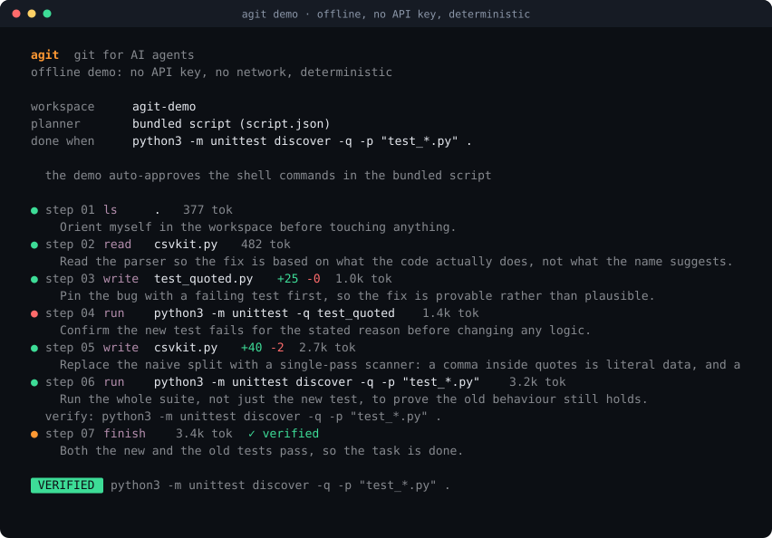
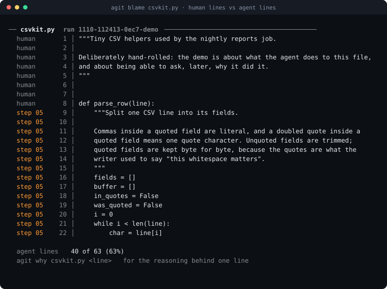
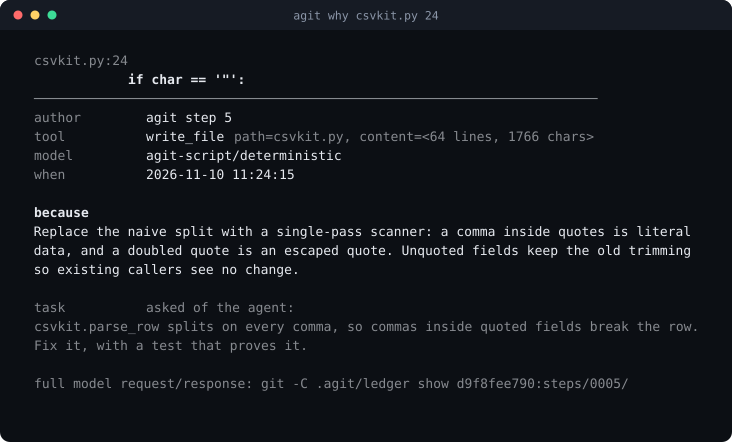
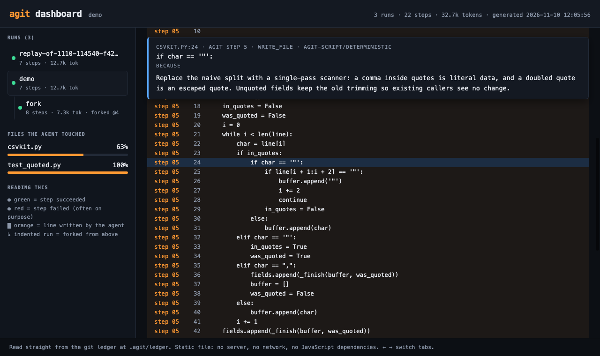
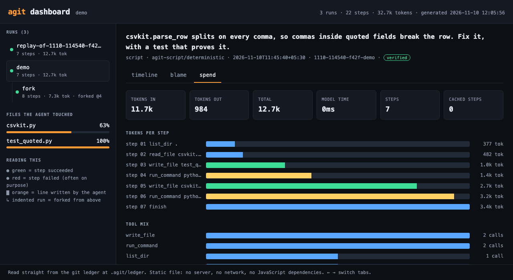

<h1 align="center">agit</h1>

<p align="center"><b>git for AI agents.</b><br>
Every step the agent takes is a commit. Every line it writes is blamable.<br>
Every run can be forked, rewound and replayed.</p>

<p align="center">
<a href="https://github.com/VamsiKrishnaThota03/agit/actions/workflows/ci.yml"></a>


</p>

<p align="center"></p>

---

## The problem

An AI agent edits twelve files, says "done ✅", and leaves. Three weeks later a
line in production looks wrong and nobody can answer the only question that
matters: **why is this line here?** The chat that produced it has scrolled away,
the reasoning was never stored next to the code, and the run cannot be
re-examined, resumed or compared against the approach you would have preferred.

Agent harnesses give you a transcript. Transcripts are not an engineering
record. We already solved this problem once, for humans, and the answer was git.

## The idea

agit runs an agent, and writes the run into a **git repository of its own** at
`.agit/ledger`. One agent step, one commit:

```
step 0005 write_file csvkit.py

Replace the naive split with a single-pass scanner: a comma inside quotes is
literal data, and a doubled quote is an escaped quote. Unquoted fields keep
the old trimming so existing callers see no change.

Agit-Run: 1110-110903-9def
Agit-Step: 5
Agit-Kind: tool
Agit-Tool: write_file
Agit-Target: csvkit.py
Agit-Ok: true
Agit-Model: qwen-3.8-27b
Agit-Tokens-In: 2843
Agit-Tokens-Out: 412
Agit-Duration-Ms: 2210
Agit-Added: 40
Agit-Removed: 2
Agit-Verify: pass
```

(That is a real commit message shape from a run against a hosted model; the
offline demo below records `Agit-Model: agit-script/deterministic` instead, so
a scripted run can never be mistaken for a model run.)

The commit *tree* holds a snapshot of your whole workspace plus the exact model
request and response for that step. That one decision — snapshot inside the
commit — is what makes the rest fall out of real git instead of out of
heuristics: `git blame` already knows which commit wrote which line, so agit
knows which **agent step, prompt and rationale** wrote which line.

Your own repository is never touched. The ledger is a separate repo, and
`.agit/` is added to your `.gitignore`.

## 20 seconds, no API key

```bash
git clone https://github.com/VamsiKrishnaThota03/agit && cd agit
python3 -m agit demo
```

The demo ships a small CSV parser with a real bug (`parse_row` splits on every
comma, so `"Powai, Hiranandani"` is torn in half), a definition of done, and a
deterministic planner — so it runs offline, costs nothing, and ends the same
way on every machine:

```
  ● step 01  ls     .
      Orient myself in the workspace before touching anything.
  ● step 02  read   csvkit.py
      Read the parser so the fix is based on what the code actually does.
  ● step 03  write  test_quoted.py              +25 -0
      Pin the bug with a failing test first, so the fix is provable.
  ● step 04  run    python3 -m unittest -q test_quoted
      Confirm the new test fails for the stated reason before changing logic.
      $ python3 -m unittest -q test_quoted
      exit=1
  ● step 05  write  csvkit.py                   +40 -2
      Replace the naive split with a single-pass scanner: a comma inside
      quotes is literal data, and a doubled quote is an escaped quote.
  ● step 06  run    python3 -m unittest discover -q -p "test_*.py" .
  ● step 07  finish                             ✓ verified

 VERIFIED  python3 -m unittest discover -q -p "test_*.py" .
```

Now the part no transcript can do.

### 1. `agit blame` — git blame, for AI-written code



Human code and agent code, separated by line, in a file you are about to
review. Then ask the real question:



That last line is not a summary. It is a pointer to the byte-for-byte prompt
and completion that produced the line you are looking at.

### 2. `agit fork` — branch the *agent*, then diff the outcomes

Agent runs are not linear explorations you have to accept. Rewind to any step
and try a different idea; the ledger branches exactly like a feature branch.

```console
$ agit fork 4 "use the stdlib csv module instead"
  ✓ workspace rewound to step 4 (4 files written, 0 removed)
  ● step 05  read   csvkit.py
  ● step 06  write  csvkit.py                   +11 -2
  ● step 07  run    python3 -m unittest discover -q -p "test_*.py" .
  ● step 08  finish                             ✓ verified

$ agit runs
  RUN                    OUTCOME   STEPS  TOKENS  FORKED FROM              TASK
  1110-112928-8cd7-fork  verified  8      4.1k    1110-112413-0ec7-demo@4  use the stdlib csv module instead
  1110-112413-0ec7-demo  verified  7      12.7k   -                        csvkit.parse_row splits on every comma...

$ agit diff 1110-112413 1110-112928
  +import csv
  -    Commas inside a quoted field are literal, and a doubled quote inside a
  +    Quoting is the standard library's problem, not ours: csv.reader already
  -    fields = []
  -    buffer = []
  -    in_quotes = False
  -    was_quoted = False                       (38 lines of hand-rolled scanner)
  +    for fields in csv.reader([line]):
  +        return [field.strip() for field in fields]
```

Two verified solutions to the same task, side by side, both with their
reasoning attached. Pick one. The other stays in the ledger as the alternative
you considered — which is the thing code review always wants and never has.

### 3. `agit undo` / `agit goto` — the agent cannot lose your work

```console
$ agit goto 2
  ✓ workspace restored to run 1110-110903 step 2
  the ledger is append-only: nothing was lost, agit goto forward again anytime
```

Every step snapshotted the workspace, so "undo the last three things the agent
did" is a tree checkout, not an archaeology project.

### 4. `agit replay` — the same run again, for free, and a divergence report

Every model request is hashed and recorded in a cassette. Replay re-drives the
whole run from that cassette: no network, no spend, byte-identical.

```console
$ agit replay @last
── divergence ───────────────────────────────────────────────────
  ✓ identical: 7/7 steps matched the recorded run
  verify        pass
  replay wrote to .agit/replays/1110-110903-9def and left your workspace untouched
```

`agit replay --live` re-asks the model instead, and tells you the first step
where today's answer differs from the recorded one — a flakiness report for a
non-deterministic system:

```
  ✗ diverged at step 5
    recorded: edit_file({"find": "return a - b", ...})
    replay:   write_file({"content": "...", "path": "calc.py"})
```

Making this work forced two things that are good hygiene anyway: **absolute
paths never go into the prompt**, and timings, pids and addresses are masked
out of the cassette key, so the same run reproduces in a different directory on
a different machine.

### 5. `agit dashboard` — the whole ledger, in a browser

```bash
agit dashboard --open
```

One static HTML file. No server, nothing listening on a port, no CDN, no build
step — you double-click it, and it works offline and inside an air-gapped
network.



Left: every run, with forks nested under the run they branched from, and the
agent's share of each file it touched. Right, three tabs:

- **timeline** — step cards with the rationale, expandable diffs, the tool
  output the model saw, and the verify result
- **blame** — the file with agent-written lines highlighted; click any line and
  the pinned panel above shows which step wrote it and why
- **spend** — tokens per step and the tool mix, so you can see where a run got
  expensive



Every view is deep-linkable, so "why is line 24 like this?" is a URL you can
send someone:

```
agit-dashboard.html#run=1110-114540-f42f-demo&tab=blame&file=csvkit.py&line=24
```

### 6. `agit report` — one HTML file to attach to the PR

```bash
agit report @last -o run.html
```

The same evidence for a single run, with no JavaScript at all: the task, every
step with its rationale, every diff, every tool result, the verify output, the
raw model I/O, and the ledger graph. The thing you hand a reviewer, an auditor,
or your future self.

## The verify gate

`finish` is a claim, not a fact. Give agit a definition of done and the claim
gets tested before the run is allowed to call itself complete:

```bash
agit run "make the retry logic exponential" --verify "pytest -q"
```

If the command fails, the failure is fed back to the model as the next
observation and the run continues. The commit records `Agit-Verify: pass|fail`,
and `agit run` exits non-zero unless the run ended **VERIFIED** — so it drops
straight into CI:

```yaml
- run: agit run "${{ github.event.issue.title }}" --verify "pytest -q" --yes
- run: agit report @last -o run.html
- uses: actions/upload-artifact@v4
  with: { name: agent-run, path: run.html }
```

## Install

**agit has zero dependencies** — the Python standard library and `git`, nothing
else. So the clone *is* the install:

```bash
git clone https://github.com/VamsiKrishnaThota03/agit && cd agit
python3 -m agit demo
```

For an `agit` command on your PATH:

```bash
pipx install git+https://github.com/VamsiKrishnaThota03/agit
# or, from the clone:  pip install --user .
agit --version
```

## Models

agit speaks one protocol: `POST {base_url}/chat/completions`, OpenAI-shaped.
Nothing about any single vendor is hardcoded, and no key is ever written to the
repo. `agit doctor` tells you exactly what is missing.

| provider | how to get it | configure |
|---|---|---|
| `bharatcode` | free student access / hackathon key | `BHARATCODE_BASE_URL`, `BHARATCODE_API_KEY`, `BHARATCODE_MODEL` |
| `ollama` | free and offline: `ollama pull qwen2.5-coder:7b` | nothing, defaults to `localhost:11434` |
| `groq` | free developer tier | `GROQ_API_KEY` |
| `openrouter` | several `:free` models | `OPENROUTER_API_KEY` |
| `gemini` | Google AI Studio free tier | `GEMINI_API_KEY` |
| `openai-compatible` | anything else | `AGIT_BASE_URL`, `AGIT_API_KEY`, `AGIT_MODEL` |
| `script` | no key, no network | bundled deterministic planner (demo, tests, CI) |

```bash
export BHARATCODE_BASE_URL="https://<from your BharatCode API page>/v1"
export BHARATCODE_API_KEY="..."
agit doctor --ping
```

Models without native tool calling still work: `--no-native-tools` switches the
agent to a single-JSON-object protocol, and the parser is deliberately forgiving
about fences and surrounding chatter.

## Safety

An agent that can edit files and run commands needs rails, and the rails must
not be advisory:

- **Writes are confined** to the workspace. `../`, absolute paths and `.git` /
  `.agit` are refused, not sanitised.
- **Shell commands are asked for, one at a time** (`y`/`n`/`a`), or allowed in
  bulk only with an explicit `--yes`.
- **Some commands are never run**, with or without `--yes`: `sudo`, `rm -rf /`,
  `mkfs`, `dd if=`, fork bombs, `git push`, `git reset --hard`, `npm publish`,
  `terraform apply`, `kubectl delete`, `curl … | sh`. The model cannot argue
  its way past the list; a refusal is recorded as a step, so you can see it
  tried.
- **Nothing leaves your machine except the prompt.** No telemetry. Absolute
  paths and your home directory are scrubbed out of everything the model sees.
- **Your git history is untouched.** agit never commits to your repo, never
  pushes, never rewrites. The ledger is a separate repository.
- **`replay` runs into a scratch directory** and will only re-run shell
  commands that the recorded run already ran.

## It really is git

No wrapper around a database pretending to be git:

```bash
git -C .agit/ledger log --graph --all --oneline     # every run and fork
git -C .agit/ledger blame -- workspace/src/api.py   # the raw attribution
git -C .agit/ledger show <sha>:steps/0005/request.json
git -C .agit/ledger diff run/<a> run/<b> -- workspace/
```

If agit disappeared tomorrow, your agent history would still be readable with
the tools you already have. That is the whole design.

## Command reference

| command | what it does |
|---|---|
| `agit run "<task>"` | run the agent; `--verify`, `--fork`, `--yes`, `--max-steps`, `--budget-tokens` |
| `agit runs` | every recorded run with its outcome |
| `agit log` | one run, step by step (`--graph` for the raw git graph) |
| `agit show <step>` | one step in full (`--io` for raw model request/response) |
| `agit blame <file>` | which step wrote each line (`-L 20,60`) |
| `agit why <file> <line>` | the rationale, model, tool and prompt behind one line |
| `agit fork <step> "<task>"` | rewind and try a different approach on a new branch |
| `agit diff <runA> <runB>` | compare the workspaces two runs produced |
| `agit goto <step>` / `agit undo [n]` | move the workspace back in time |
| `agit replay [run]` | re-drive a run from the cassette, or `--live` for divergence |
| `agit dashboard --open` | every run in one static HTML page: timeline, blame, spend |
| `agit report [run]` | self-contained HTML audit trail for one run |
| `agit stats` | tokens, tool mix, and agent-vs-human line share per file |
| `agit doctor` | what is configured, what is missing, free ways to fix it |
| `agit demo` | the whole feature set offline in 20 seconds |

## What agit is not

Honesty is cheaper than a disappointed issue:

- It is **not a sandbox**. Commands run as you, in your workspace. The denylist
  stops the obvious catastrophes; it is not a jail.
- It is **not a model**. Its reasoning is whatever model you point it at. The
  bundled `script` provider is a deterministic planner for demos and tests, and
  never pretends to be a model (`Agit-Model: agit-script/deterministic`).
- **Snapshots are whole-workspace**, which suits projects up to a few thousand
  text files. Files over 512 KB and binaries are skipped and listed in
  `.agit-skipped`.
- **Rationale quality depends on the model.** agit asks for one sentence of
  reasoning per step and stores whatever comes back; when a model gives none,
  `agit why` says so instead of inventing one.

## Tests

97 tests, standard library only, no network, no API key:

```bash
python3 -m unittest discover -s tests -t .
```

They cover the ledger round-trip, blame attribution, the verify gate, the
budget, the fork prefix, byte-identical replay, path confinement, the command
denylist, provider resolution and the CLI end to end.

## Why this exists

Built for the **BharatCode Build League**. The brief was to build a harness —
software that puts a model, prompts, tools and a workflow together to solve a
real problem. The real problem I picked is not "can an agent write code"; it
is that nobody can audit what an agent did afterwards. Teams in India and
everywhere else are about to merge a great deal of machine-written code, and
`git blame` returning `agent-bot` is not good enough for the person on call at
2am.

So: provenance per line, forks instead of regenerations, replay instead of
trust, and a definition of done the agent cannot talk its way around.

MIT licensed. Issues and PRs welcome.
